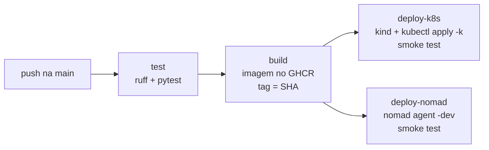

# RU-ômetro


API para avaliar as refeições do RU (bandejão). Trabalho final da disciplina de DevOps (UFLA): o foco é o **pipeline de CI/CD** (teste → build → deploy), com deploy em **Kubernetes** e **Nomad**.

- **Stack:** Python 3.12, FastAPI, Uvicorn
- **Persistência:** em memória (com dados de exemplo no startup)
- **CI/CD:** GitHub Actions → imagem no GHCR → deploy em kind (K8s) e Nomad efêmeros
- **Documentação interativa:** `/docs` (Swagger)

## Vídeo de apresentação

🎥 [Assista ao vídeo (Google Drive)](https://drive.google.com/file/d/1LI5_Y_sNk-C10p6_ecK-tKTPPIEOWbhr/view?usp=drive_link): o pipeline rodando e o deploy em Kubernetes e Nomad.

## Endpoints

| Método | Rota | Descrição |
|---|---|---|
| GET | `/health` | `{"status": "ok", "version": "<APP_VERSION>"}` |
| GET | `/refeicoes` | Lista (filtros: `?tipo=almoco\|jantar`, `?vegetariano=true`) |
| GET | `/refeicoes/{id}` | Detalhe (404 se não existir) |
| POST | `/refeicoes` | Cria uma refeição (201) |
| DELETE | `/refeicoes/{id}` | Remove a refeição e as avaliações (204) |
| POST | `/refeicoes/{id}/avaliacoes` | Avalia com nota de 1 a 5 (201; 404; 422) |
| GET | `/refeicoes/{id}/avaliacoes` | Lista as avaliações da refeição |
| GET | `/ranking` | Ranking por média (`?ordem=melhores\|piores`, `?limite=5`) |

Exemplo:

```bash
curl -X POST localhost:8000/refeicoes -H "Content-Type: application/json" \
  -d '{"nome": "Feijoada", "tipo": "almoco", "data": "2026-11-26"}'
curl -X POST localhost:8000/refeicoes/1/avaliacoes -H "Content-Type: application/json" \
  -d '{"nota": 5, "comentario": "Melhor do semestre"}'
curl localhost:8000/ranking
```

### Variáveis de ambiente

| Variável | Default | Descrição |
|---|---|---|
| `APP_VERSION` | `dev` | Versão da imagem (no pipeline, o SHA do commit) |
| `APP_NAME` | `RU-ometro` | Nome da aplicação |
| `SEED_DATA` | `true` | Carrega refeições e avaliações de exemplo |
| `LOG_LEVEL` | `info` | Nível de log |

## Pipeline



Arquivo: [`.github/workflows/ci-cd.yml`](.github/workflows/ci-cd.yml)

| Job | O que faz |
|---|---|
| `test` | Instala as dependências, roda `ruff check .` e `pytest -v` |
| `build` | Builda a imagem com `APP_VERSION=<sha>` e publica `ghcr.io/luskation/ru-ometro:<sha>` (e `latest`) |
| `deploy-k8s` | Cria um cluster **kind** no runner, aplica os manifestos com a imagem do commit, espera o rollout e faz o smoke test |
| `deploy-nomad` | Sobe um **`nomad agent -dev`** no runner, roda o job e faz o smoke test (em paralelo com o K8s) |

**Decisões:**

- **Gatilhos:** em pull request roda só o `test`; build e deploys rodam em push na `main` ou manualmente (`workflow_dispatch`).
- **Ambientes efêmeros:** o cluster kind e o agent do Nomad nascem e morrem dentro do runner. Sem custo, sem credencial de cloud, e o deploy é reproduzível a cada execução.
- **Tag por SHA:** cada imagem é identificada pelo commit que a gerou, então dá pra saber exatamente o que está no ar.
- **Smoke test com versão:** após cada deploy, o pipeline chama o `/health` e confere se `version` é **igual ao SHA do commit**. Isso prova que a versão nova realmente subiu, e não uma antiga.
- **Imagem mínima e segura:** Dockerfile multi-stage, `python:3.12-slim`, usuário não-root (UID 1000).

### Kubernetes x Nomad

| Kubernetes (`k8s/`) | Nomad (`nomad/ru-ometro.nomad.hcl`) |
|---|---|
| `Deployment` (2 réplicas) | `group "api"` + `task "api"` |
| `Service` (ClusterIP 80 → 8000) | `service` + `network` (porta 8080 → 8000) |
| `readinessProbe` / `livenessProbe` | `check` HTTP no `/health` |
| `RollingUpdate` (`maxUnavailable: 0`) | `update` (`max_parallel = 1`, `auto_revert`) |
| `ConfigMap` + `envFrom` | bloco `env` |
| `resources` (requests/limits) | `resources` (cpu/memory) |
| `kustomize edit set image` | `-var "image=..."` |

### Pacote do GHCR público

O pacote nasce **privado** no GHCR. Depois do primeiro push, é preciso deixá-lo **público** para o kind e o Nomad conseguirem baixar a imagem sem credencial:

`github.com/luskation` → **Packages** → **ru-ometro** → **Package settings** → **Change visibility** → **Public**.

## Como rodar

### Local

```bash
python -m venv .venv && source .venv/bin/activate
pip install -r requirements-dev.txt
uvicorn app.main:app --reload        # http://localhost:8000/docs
```

### Testes e lint

```bash
ruff check .
pytest -v
```

### Docker

```bash
docker build --build-arg APP_VERSION=local -t ru-ometro:local .
docker run --rm -p 8000:8000 ru-ometro:local
curl localhost:8000/health
```

### Kubernetes (kind)

```bash
kind create cluster --name ru-ometro
kind load docker-image ru-ometro:local --name ru-ometro
kubectl apply -k k8s/
kubectl -n ru-ometro rollout status deploy/ru-ometro
kubectl -n ru-ometro port-forward svc/ru-ometro 8080:80   # http://localhost:8080/docs
kind delete cluster --name ru-ometro
```

### Nomad

```bash
sudo nomad agent -dev -bind 0.0.0.0          # em outro terminal
nomad job run -var "image=ru-ometro:local" nomad/ru-ometro.nomad.hcl
curl localhost:8080/health
nomad job stop -purge ru-ometro
```

## Estrutura

```
app/            # código da API (main, config, schemas, storage, routers)
tests/          # testes com pytest + TestClient
k8s/            # manifestos Kubernetes (kustomize)
nomad/          # job do Nomad
.github/        # pipeline de CI/CD
Dockerfile      # imagem multi-stage, não-root
```
